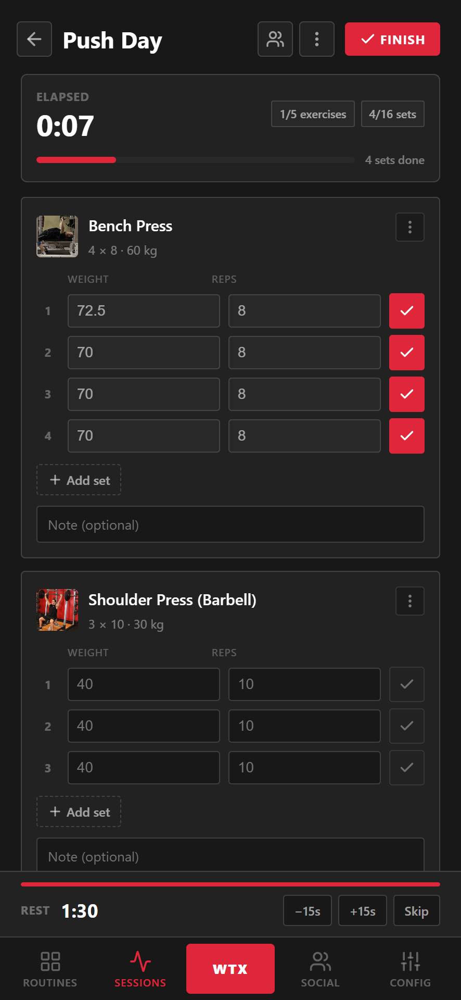
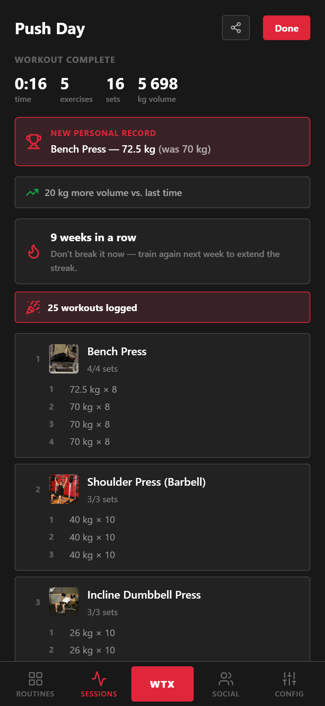
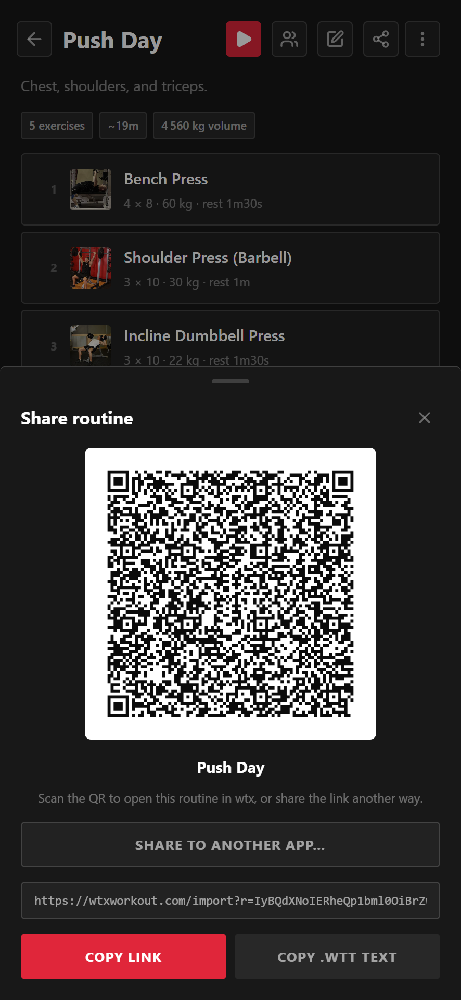
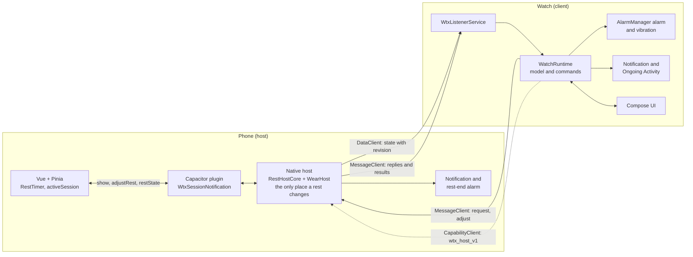
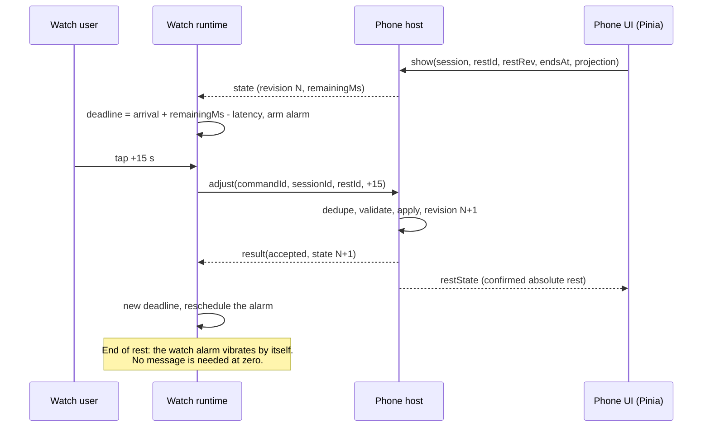
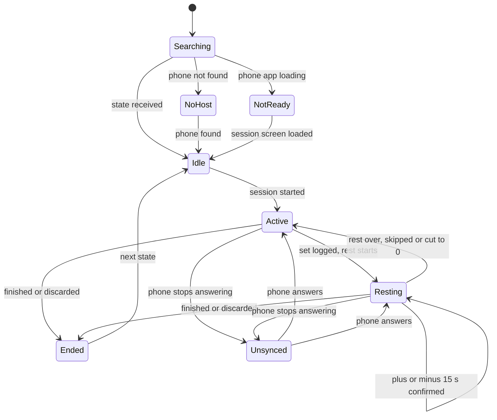

<div align="center">
  

  # wtx

  A mobile-first web client for **wtx**, a plain-text workout format.

  [](./LICENSE)
  [](https://vuejs.org/)
  [](https://www.typescriptlang.org/)
  [](https://vite.dev/)
</div>

Keep your training routines as small, human-readable `.wtt` files, then load,
build, and share them from your phone.

Everything lives in the browser: routines are stored in `localStorage`, and
sharing is done with self-contained links and QR codes that carry the whole
routine in the URL.

## Contents

- [Screenshots](#screenshots)
- [Features](#features)
- [The `.wtt` format](#the-wtt-format)
- [Tech stack](#tech-stack)
- [Getting started](#getting-started)
- [Wear OS](#wear-os)
- [Project structure](#project-structure)
- [The wtx parser](#the-wtx-parser)
- [Legal pages](#legal-pages)
- [License](#license)

## Screenshots

<table>
  <tr>
    <td align="center" width="33%">
      <br>
      <sub>Log a workout</sub>
    </td>
    <td align="center" width="33%">
      <br>
      <sub>Records and streaks</sub>
    </td>
    <td align="center" width="33%">
      <br>
      <sub>Share via QR</sub>
    </td>
  </tr>
</table>

## Features

- **Templates library** — every `.wtt` routine you've added, parsed into a
  readable summary (exercise count, total sets, muscle groups).
- **Load a routine** three ways:
  - paste `.wtt` text,
  - pick a `.wtt` file,
  - scan a QR code with the camera, or from an image.
- **Create a routine** with a form that serializes back to valid `.wtt` text.
- **Share via QR** — generates an import link (`/import?r=…`, the routine
  base64url-encoded into the query) and renders it as a QR code. Scanning it on
  another device opens the app with the routine ready to add.
- **Configurable accent color**, remembered across visits.
- **Sessions** — log a workout against a routine, with a rest timer, live PR
  detection, a review step before finishing, and a training calendar.
- **Social** (optional, see below) — sync your library across devices and
  train live with friends in a group-workout room: shared countdown, live
  progress, cheers, and a recap once everyone's done.

## The `.wtt` format

A template is a name line, optional `key: value` metadata, and one exercise per
line:

```
# Push Day
unit: kg
tags: strength, upper

Bench Press    | reps 4x8   | 60 | rest 1m30s | muscle Chest
Overhead Press | reps 3x10  | 30 | rest 1m
Plank          | time 1m30s
```

- `# Name` — required, the first line.
- Metadata: `unit`, `description`, `notes`, `tags` (comma-separated).
- Exercise line: `Name | <reps NxM | time DURATION> | [weight] | [rest DURATION] | [muscle Group]`.
- Durations are compact: `1m30s`, `2m`, `45s`, `1h`.

Parsing is handled by a vendored copy of the reference parser — see
[The wtx parser](#the-wtx-parser).

## Tech stack

- [Vue 3](https://vuejs.org/) (`<script setup>`) + TypeScript
- [Vite](https://vite.dev/) for dev/build, [Vitest](https://vitest.dev/) for tests
- [Pinia](https://pinia.vuejs.org/) for state, [Vue Router](https://router.vuejs.org/) for navigation
- [`qr-scanner`](https://github.com/nimiq/qr-scanner) for reading QR codes,
  [`uqr`](https://github.com/unjs/uqr) for generating them
- [`@lucide/vue`](https://lucide.dev/) icons
- Local state in `localStorage`

## Getting started

**Prerequisites:** Node `^22.18.0 || >=24.12.0` and [pnpm](https://pnpm.io/).

```sh
pnpm install
pnpm dev          # start the dev server
```

### Scripts

| Command             | What it does                                              |
| ------------------- | -------------------------------------------------------- |
| `pnpm dev`          | Vite dev server with HMR                                  |
| `pnpm build`        | Type-check (`vue-tsc`) then production build to `dist/`   |
| `pnpm build-only`   | Production build without the type-check step             |
| `pnpm preview`      | Serve the built `dist/` locally                           |
| `pnpm test:unit`    | Run the Vitest suite                                      |
| `pnpm lint`         | oxlint + ESLint, with `--fix`                             |
| `pnpm format`       | Prettier over `src/`                                      |
| `pnpm sync:wtx`     | Re-vendor the wtx parser from upstream                    |

### Accounts, sync and group workouts (Supabase)

The app works fully on-device without an account. Creating one (Social tab)
syncs routines and sessions to [Supabase](https://supabase.com/) and unlocks
group workouts. To enable it:

1. Create a Supabase project. In **Authentication → Providers**, enable Email
   (turn off "Confirm email" for quick testing).
2. Apply the schema. `supabase/migrations/` holds the standard, hand-written
   Supabase CLI migrations. Either paste `20260925000000_accounts_sync_rooms.sql`
   into the SQL editor, or use the CLI:
   ```sh
   npx supabase init        # once; keeps the existing migrations
   npx supabase link --project-ref <ref>
   npx supabase db push
   ```
   For future schema changes, scaffold a new timestamped file with
   `npx supabase migration new <description>`, write the SQL by hand, commit
   it, then `npx supabase db push` again. Never edit a migration that's
   already been applied — add a new one instead.
3. Deploy the account-deletion function with the project's secret key
   (`sb_secret_…`, never shipped in the app):
   ```sh
   npx supabase secrets set SERVICE_KEY=sb_secret_...
   npx supabase functions deploy delete-account
   ```
4. Copy `.env.example` to `.env.local` and set `VITE_SUPABASE_URL` (the bare
   `https://<ref>.supabase.co`) and `VITE_SUPABASE_ANON_KEY` (the publishable
   key, `sb_publishable_…`) from Project Settings → API Keys.

Without those variables the Social tab says accounts aren't set up, and
everything else keeps working locally.

### Moderation

The social feed is user-generated content, so the app ships the tools App
Store guideline 1.2 and Google Play's UGC policy ask for
(`supabase/migrations/20260930000000_moderation.sql`):

- **Report** — the ⋯ menu on someone's profile (Report account) or on a
  shared workout (Report post) files a row in `content_reports` with a reason
  and optional details. The app can only insert; reading and resolving
  happens in the dashboard.
- **Block** — the same ⋯ menus. Blocking removes the follows between both
  people, hides each other's profiles and workouts, and stops any follow
  path (code, "Follow back", finishing a room together). The other person
  isn't notified. Your blocked list is under your own profile → ⋯ → Blocked
  accounts.
- **Word filter** — `public.contains_blocked_terms()` (mirrored in
  `src/lib/contentFilter.ts`, keep them in sync) rejects a short list of
  slurs and explicit terms in display names and bios, and the app won't
  share a workout to the feed whose name, notes or exercise names contain
  one.

**Review reports within 24 hours** (that's the promise the app makes to
reporters). In the Supabase dashboard, open **Table Editor → content_reports**
filtered to `status = open`, or run in the SQL editor:

```sql
select r.created_at, r.reason, r.details,
       reporter.display_name as reporter, reported.display_name as reported,
       r.reported_user_id, r.session_id, s.raw_text
from content_reports r
left join profiles reporter on reporter.id = r.reporter_id
left join profiles reported on reported.id = r.reported_user_id
left join sessions s on s.id = r.session_id
where r.status = 'open'
order by r.created_at;
```

Then act and close the report:

```sql
-- Take a workout off the feed (it stays in its owner's history).
update sessions set shared = false, feed_snapshot = null where id = '<session_id>';

-- Clear an offensive name or bio.
update profiles set display_name = 'Athlete', bio = '' where id = '<user_id>';

-- Ban: delete the account. Cascades to their profile, sessions, follows and
-- kudos; reports about them are kept with reported_user_id set to null.
-- (They could sign up again with a new email.)
delete from auth.users where id = '<user_id>';

-- Close the report: 'actioned' or 'dismissed'.
update content_reports set status = 'actioned' where id = '<report_id>';
```

The dashboard doesn't alert you to new reports. For an email per report, add
a Database Webhook on `content_reports` inserts that calls an Edge Function
which sends the email — not built yet.

### Crash reporting and analytics

Both are optional and off by default.

- **Crash reporting** is [Sentry](https://sentry.io/) (`src/services/crashReporting.ts`).
  Set `VITE_SENTRY_DSN` (Settings → Client Keys in your Sentry project) to
  enable it.
- **Analytics** goes through a small provider interface
  (`src/services/analytics.ts`) so the backend can be swapped later without
  touching call sites. The default provider (`src/services/supabaseAnalytics.ts`)
  writes to an `app_events` table on the same Supabase project used for sync —
  no new vendor needed. It only starts once Supabase is configured (see
  above), and only ever inserts an event name, platform, app version, an
  acquisition source (below) and — when signed in — the account's user id
  (set to null if the account is deleted); nothing is readable back through
  the client API.

### Where installs come from

- **Source tags.** A link can carry `?src=<label>` (or `utm_source`), e.g.
  `https://<site>/?src=tiktok` in a social profile. The first label an
  install sees is kept (`src/services/acquisition.ts`) and sent with every
  analytics event. Shared links need no tag: opening a routine, room, follow
  or post link is recorded as `share-routine`, `share-room`, `share-follow`
  or `share-post`. Labels are limited to `[a-z0-9_-]`, 32 characters.
- **"Get the app" banner** (`src/components/GetAppBanner.vue`). The web build
  shows it on phones once that platform's store ID is set
  (`VITE_APP_STORE_ID`, `VITE_PLAY_STORE_ID` — see `.env.example`), and the
  store link it opens carries the source, so the store consoles can
  attribute the install. Never shown inside the native apps.
- **Rating prompt** (`src/services/appReview.ts`). Leaving the finish screen
  after a personal record or a milestone asks for a store rating through the
  system sheet, from the third workout on and at most once every 90 days.
  Native only; needs `pnpm cap:sync` for `@capacitor-community/in-app-review`.
- **Workout card** (`src/lib/workoutCard.ts`). The share button on the finish
  screen opens a preview and shares an image of the workout with the app's
  name and address on it: a 1080×1920 story card, the same numbers over a
  photo of your own, or a transparent sticker. Where images can't be shared
  it is saved instead.

### Reminders

On-device, opt-in local notifications (Configuration → Reminders) —
`src/services/notifications.ts`. A single rolling reminder that fires around
6pm local time only if nothing's been logged that day, mentioning the streak
by name once there's one worth protecting. Purely client-side, no server:
requires the app to have run `pnpm cap:sync` at least once so the native
projects pick up `@capacitor/local-notifications`.

This does not cover push notifications (e.g. "a friend invited you to a
room") — those need a friend to reach a device the app isn't currently open
on, which needs real push infrastructure (Firebase Cloud Messaging /
Apple Push Notification service, both requiring their own accounts and
native setup), not just this plugin.

## Wear OS

A Wear OS app (`android/wear`, Kotlin + Compose for Wear OS) that shows the rest
countdown of the session you are running on the phone, lets you move it by ±15 s,
vibrates when it ends and says what comes next. The phone stays in charge of the
session; the watch is a client of it. No backend is involved: the two devices talk
over the Wearable Data Layer.

### What the MVP does, and what it does not

| On the watch | |
| --- | --- |
| Rest countdown | Big `mm:ss`, redrawn locally from a deadline (no per-second messages) |
| ±15 s | Sent to the phone as a command; shown as applied only when the phone confirms it |
| Next action | Another set (`Set 2 of 3 · 60 kg × 8`) or the next exercise, in the phone's language and units |
| End of rest | Vibrates once, from a local alarm, even with the screen off or the app closed |
| Outside the app | Notification + Ongoing Activity with a system-drawn countdown |
| States | Searching / no phone, phone without session, session without rest, resting, not synced, ended |

Out of scope: logging sets from the watch, sensors and heart rate, editing routines, cloud
sync, the stopwatch of timed exercises (a rest only exists between sets).

The ±15 s buttons use the same rule as the phone's: `−15 s` clamps at 0 (the rest ends),
and the routine's configured rest time is never changed, only the running rest.

### Who does what

| Piece | Responsibility |
| --- | --- |
| Phone UI (Vue, Pinia — `RestTimer.vue`, `stores/activeSession.ts`) | Session data, logging sets, the rest panel. Reads rest state back from the host; never adds `±15` blindly |
| Capacitor bridge (`services/sessionNotification.ts`, plugin `WtxSessionNotification`) | Sends the session, the rest and a small projection of what to show next to the native side; relays the confirmed rest back to Pinia (`restState` event); calls `adjustRest` |
| Native host (`RestHostCore`, `WearHost`, `WearHostListenerService`, `SessionNotificationPlugin` in `android/app`) | **The only place a rest change is applied**: phone buttons, the notification and the watch all go through it. Works with the web view paused. Dedupes commands, rejects stale ones, keeps a monotonic revision, publishes the state, answers requests and commands |
| Watch (`android/wear`) | Shows the host's state, sends commands, keeps a local end-of-rest alarm, never decides the rest |

Rules that follow from that:

- Every rest has an identity (`restId`) and a revision (`restRev`). JS and native each hold a
  copy; native wins. A late JS write cannot overwrite a native adjustment, and when the web
  view resumes it reconciles before a natural end is processed.
- Two legitimate taps before a new revision arrives are both applied (each is its own
  command with its own `commandId`).
- The host's revision is persisted, so after a restart it still grows; a new install gets a
  new `hostId`, and the watch then drops its old state.

### Module and files

```
android/
  protocol/wear-v1.json            Contract fixtures, read by the TS, Java and Kotlin tests
  app/src/main/java/com/wtxworkout/app/
    RestHostCore.java              Pure rest rules (adjust, dedupe, revisions). Unit-tested
    WearProtocol.java              Paths, payload validation, JSON for state/result
    WearHost.java                  Data Layer side of the host (publish, requests, commands)
    WearHostListenerService.java   Manifest-declared WearableListenerService (no Activity)
    SessionNotificationPlugin.java Capacitor plugin + notification, now backed by WearHost
  wear/src/main/kotlin/com/wtxworkout/wear/
    WearProtocol.kt                Paths, payload validation (same contract)
    WatchModel.kt                  Pure model and rules: ordering, countdown, latency, screens
    RestAlarmPlanner.kt            Pure decision: keep / schedule / cancel / fire-now
    RestAlarms.kt                  AlarmManager alarm, vibration, receivers (alarm, boot)
    RestNotifier.kt                Notification + Ongoing Activity
    WatchRuntime.kt                Transport, command tracking, effects (alarm, notification)
    WtxListenerService.kt          Manifest-declared listener for the phone's messages
    WatchScreens.kt / WatchPreviews.kt   Compose UI (pure) and its previews
    MainActivity.kt, WtxTheme.kt
src/lib/
  sessionNextAction.ts             The one place that decides "what is next" (set / exercise / done)
  wearProjection.ts                What the watch needs of that, already translated
  wearProtocol.ts                  TS side of the contract
```

"What is next" is decided once, in TypeScript, and shared by the phone notification and the
watch; the watch only lays out the text it receives, so the selection logic is not
duplicated in Kotlin.

### Requirements, build and run (Windows / PowerShell)

- JDK 17+ (Android Studio's bundled JBR works), Android SDK with API 36, Node + pnpm.
- One phone and one watch (emulators or devices). On Windows, `node`/`pnpm` may not be on the
  `PATH` of a fresh shell: `$env:Path = "C:\Program Files\nodejs;$env:APPDATA\npm;" + $env:Path`.

```powershell
# 1. Web app into the phone project (build-only: does not regenerate the legal pages)
pnpm build-only
npx cap copy android

# 2. Both APKs
cd android
.\gradlew.bat :app:assembleDebug :wear:assembleDebug
#   phone: android\app\build\outputs\apk\debug\app-debug.apk
#   watch: android\wear\build\outputs\apk\debug\wear-debug.apk

# 3. Install. With several devices always name the target, and never cross the APKs.
adb devices
adb -s <phone-serial> install -r app\build\outputs\apk\debug\app-debug.apk
adb -s <watch-serial> install -r wear\build\outputs\apk\debug\wear-debug.apk
adb -s <watch-serial> shell am start -n com.wtxworkout.app/com.wtxworkout.wear.MainActivity
```

Checks that should pass before a change is reviewed:

```powershell
pnpm test:unit                                   # includes the wear protocol and projection specs
pnpm exec vue-tsc --build
cd android
.\gradlew.bat :app:testDebugUnitTest :wear:testDebugUnitTest :wear:lintDebug
```

Node 26 needs `NODE_OPTIONS=--no-experimental-webstorage` for Vitest (`localStorage`).

### Application ids and signing

The Data Layer finds the other app by **application id and signing certificate**, so both
modules must install with the same id and be signed by the same key:

| | `:app` (phone) | `:wear` (watch) |
| --- | --- | --- |
| `applicationId` | `com.wtxworkout.app` | `com.wtxworkout.app` |
| Debug suffix | none | none (add the same suffix to both if one is ever added) |
| Code namespace | `com.wtxworkout.app` | `com.wtxworkout.wear` |
| Debug signing | `~/.android/debug.keystore` | same keystore |

Verify with `.\gradlew.bat :app:signingReport :wear:signingReport` (the SHA-256 of the
`debug` variant must match). For release, sign both with the same release key (or use
Play App Signing for both); that is not configured in this repo.

### Pairing the emulators, or a real watch

Emulators (what the flow below was tested on): create a phone image **with Google Play**
and a Wear OS image, start both, and pair them from Android Studio (Device Manager →
the watch → *Pair Wearable Devices*), or with the Wear OS companion app on the phone
emulator. Android Studio sets up a `adb forward` to the phone's port 5601 for you. Then:

```powershell
adb -s <phone-serial> shell dumpsys activity service com.google.android.gms/.wearable.service.WearableService
# on the watch, "Reachable Nodes" must list the phone with hops 1 / isNearby true
```

Physical phone + watch (e.g. a Galaxy Watch6): pair them with the usual companion app
(Galaxy Wearable), enable developer options on the watch, turn on *ADB debugging* and
*Debug over Wi-Fi*, then `adb pair <ip:port>` and `adb connect <ip:port>`, and install
`wear-debug.apk` on that serial. The phone app and the watch app must come from the same
keystore. (A physical phone paired with a watch *emulator* is the other mixed setup: Google's
docs have you run `adb -d forward tcp:5601 tcp:5601` for it.)

### Architecture



### Protocol (version 1)

Everything is a UTF-8 JSON object with `"v": 1`. Unknown versions are rejected
(`unsupported_version`); malformed payloads are ignored by the watch and answered
`invalid_payload` by the phone. The exact shapes are pinned by
`android/protocol/wear-v1.json`, which three test suites read (TypeScript, Java, Kotlin).

| What | How | Path / name |
| --- | --- | --- |
| Host discovery | CapabilityClient | `wtx_host_v1` (declared by the phone app, `res/values/wear.xml`) |
| State | DataClient (DataItem, urgent) on every change; also sent as a message in reply to a request | `/wtx/v1/session/state` |
| Ask for the state | MessageClient, watch → phone | `/wtx/v1/session/request` `{v, requestId}` |
| Move the rest | MessageClient, watch → phone | `/wtx/v1/timer/adjust` `{v, commandId, sessionId, restId, deltaSeconds}` |
| Answer to a command | MessageClient, phone → watch | `/wtx/v1/command/result` `{v, commandId, accepted, reason, duplicate, state}` |

State payload:

```json
{
  "v": 1, "hostId": "host-1", "revision": 42, "inReplyTo": "req-1",
  "status": "resting",
  "sessionId": "s-1",
  "rest": { "restId": "r-1", "remainingMs": 90000, "durationMs": 90000 },
  "stepSeconds": 15, "vibrate": true, "sessionName": "Push day",
  "next": { "kind": "set", "exercise": "Bench Press", "position": "Set 2 of 3", "load": "60 kg × 8" }
}
```

- `status`: `not_ready` (the phone app's process is up but its screen has not loaded the session),
  `idle`, `active` (session, no rest), `resting`, `ended` (`endedReason`: `finished` / `discarded`).
- `next.kind`: `set`, `exercise` or `done`. `position` and `load` are already translated and
  formatted by the phone.
- **Units:** all times are milliseconds; `deltaSeconds` is seconds (a whole number, not 0,
  at most ±60). `remainingMs` is *relative to the moment the phone built the state*, never an
  absolute time: the two clocks are not the same clock.
- **Revisions:** `revision` grows by one with every change of what the watch can see, across
  restarts. The watch ignores a state with a lower revision from the same `hostId` (messages and
  DataItems can arrive out of order). A different `hostId` replaces the old state.
- **Commands:** `commandId` identifies one tap; `sessionId` and `restId` say which rest the user
  was looking at. The phone checks, in this order: duplicate (answers the same result again,
  `duplicate: true`, applies nothing), `not_ready`, `no_session`, `session_mismatch`,
  `rest_mismatch` (another rest began), `rest_ended`, then applies and bumps the revision. It
  remembers the last 64 command ids.
- **Result:** `accepted` with the state *after* the command, or `reason` with the current state
  so the watch can show the truth. The watch only shows a tap as applied when the result says so.
- `state.vibrate` is the phone's "vibrate on rest end" setting.

The phone's own rest panel, its notification actions and the watch all call the same
`adjust`: one rule, one place.

### A rest, from the watch's point of view



### Watch states



`Unsynced` is an overlay on the last confirmed state: it keeps showing it (with the countdown
still running) marked "Not synced", with ±15 s disabled.

### Time, clocks and the end of a rest

- **Phone:** the deadline lives on the monotonic clock (`elapsedRealtime`), the same one the
  notification's chronometer counts on. The web view gets it as an epoch time.
- **Watch:** on arrival it converts `remainingMs` into a **local monotonic deadline**:
  `arrival + remainingMs − latency`. Latency is half of the request→reply round trip, smoothed
  (EWMA, capped at 2 s, 150 ms before the first sample). The countdown is
  `max(0, deadline − now)`, shown rounded up like the phone's, so it is never negative.
- A state nobody asked for is trusted only if the watch was already in sync. After a
  disconnection the Data Layer delivers whatever was published meanwhile and its
  `remainingMs` is that old; the watch shows it but stays "not synced" until the phone answers
  a request (it asks immediately).
- No message per second. Messages happen on change, on opening the screen, on reconnecting,
  and — only while the screen is on and a rest is running — one request every 10 s to notice
  silence (3 s without an answer = not synced).
- **Vibration policy.** It vibrates once per rest, only for a **natural end**. Not when the user
  cuts the rest to 0 with −15 s or skips it (they are looking at the screen), not when the
  session ends or is discarded, and not when the phone's "vibrate on rest end" is off. The one
  exception is deliberate: a rest the phone reports over in the last 1.5 s before the alarm
  counts as natural (it is what the same end looks like with a little latency).
- **Alarm.** A single `AlarmManager` alarm (`ELAPSED_REALTIME_WAKEUP`) wakes a manifest
  receiver, which vibrates (alarm usage) and clears the notification. It is rescheduled when
  the deadline moves (more than 0.75 s, to ignore latency jitter), replaced for a new rest
  and cancelled for cancel, session end or a new state without a rest. `vibratedRestId`
  (persisted) stops a second vibration for the same rest however often its state arrives.
- **Why not a wake lock or a foreground service** (the phone holds a wake lock): a rest is a
  short wait with the wrist down, and the watch battery is small. An alarm costs nothing while
  waiting; the countdown in the notification is drawn by the system from an end time, so the
  app does no work per second.

### Disconnection and recovery

| Situation | Behaviour |
| --- | --- |
| Phone not reachable | Last confirmed state stays, countdown keeps running, "Not synced", ±15 s disabled, taps are **not** queued. The alarm stays armed |
| Reachable again | Asks for the state; trusted when the phone answers; any adjustment made on the phone meanwhile appears |
| Command without an answer | One resend with the same `commandId` (the phone dedupes), then "the phone did not answer" and a state request |
| Command rejected | The reason is shown (rest already ended, another rest, session changed…), with the phone's current state |
| Screen off | Alarm still fires, notification stays. Nothing runs per second |
| Activity paused | The listener service keeps updating state, alarm and notification |
| Watch app process killed | The alarm (a `PendingIntent` to a manifest receiver) restarts the process and vibrates; state is kept in `SharedPreferences` |
| Watch reboot | Alarms are cleared by the system. The capability listener (manifest) and a `BOOT_COMPLETED` receiver ask the phone for the state and re-arm the alarm if the rest is still running. Needs the phone reachable |
| Force stop of the watch app | Android clears the alarm and stops the app, so the end vibration is lost *until the Data Layer wakes the app again* (a reconnect or a phone update). It then notices that its alarm is gone (the stored alarm is checked against the system, not only against saved state) and re-arms it with the same deadline. Verified on the emulator by force-stopping the app and restarting GMS; if the link never changes, nothing wakes the app, so this is **not** a guaranteed case |
| Phone app process killed | The phone host starts empty (`not_ready`): the watch shows "Open WTX on your phone" until the web view reloads the session. The host's `hostId` and revision survive, so the watch's ordering is not confused |

### Permissions and restrictions

| Permission | Why | If refused |
| --- | --- | --- |
| `POST_NOTIFICATIONS` (API 33+, asked once on first open) | Notification + Ongoing Activity | The countdown is only visible in the app; the alarm and vibration still work |
| `SCHEDULE_EXACT_ALARM` | Exact end-of-rest alarm | **Not granted by default.** The alarm is then inexact (`setAndAllowWhileIdle`) and Android may delay it by seconds or more; the app does not promise punctuality in that case. Grant it where the watch's settings offer it (*Alarms & reminders* for the app), or `adb shell cmd appops set com.wtxworkout.app SCHEDULE_EXACT_ALARM allow` for tests |
| `VIBRATE` | The vibration | — |
| `RECEIVE_BOOT_COMPLETED` | Re-arm after a reboot | Without it, a reboot is only recovered when the Data Layer reconnects and wakes the app |

The phone's "vibrate on rest end" setting is carried in the state and is the watch's
setting too: off means no alarm is set at all. There is no separate watch preference.

### Testing

Automated (all in the checks above): next-set / next-exercise projection (TS), command
dedupe, other-rest and ended-session rejection, consecutive adjusts, reaching zero
(Java `RestHostCoreTest`), the stale-JS and reconcile rules (TS `activeSessionHostedRest.spec.ts`),
out-of-order states, latency and countdown (`WatchModelTest`), and alarm keep / reschedule / cancel /
fire-now (`RestAlarmPlannerTest`); the three protocol suites read the same fixtures.

By hand on two emulators (phone with the app logged in, watch):

1. Start a session on the phone and log a set. The watch goes from "Start a session on your
   phone" to "No rest", then to the rest with the next set or exercise.
2. Tap +15 s on the watch: both show the same time. Tap −15 s on the phone: the watch follows.
3. Compare with the phone notification (its −15 s/+15 s and time match).
4. Let the rest end: the watch drops to "No rest"; check one vibration:
   `adb -s <watch> shell dumpsys vibrator_manager` (an `ALARM` entry from `com.wtxworkout.app`) and
   `adb -s <watch> shell dumpsys alarm` (the alarm is pending during the rest, gone after).
5. Disconnect (see below), change the rest on the phone, reconnect: the watch shows "Not synced"
   and then the new state.
6. Finish or discard the session during a rest: the watch shows "Session finished/discarded", the alarm
   and the notification are gone, no vibration.
7. Screen off + `adb shell am kill com.wtxworkout.app` (after going Home) during a rest: the vibration still
   happens at the end and the process comes back.

To cut the link on emulators: remove Google's route to the phone by also blocking GMS networking
(`adb -s <serial> shell cmd connectivity set-package-networking-enabled false com.google.android.gms`,
and `airplane-mode enable` on the phone), kill `com.google.android.gms` a few times, and
undo it with `…enabled true`, re-adding the `adb forward` Android Studio created, and force-stopping GMS on the
watch. Without blocking the cloud route the watch usually stays reachable through it.

### Troubleshooting

- *The watch says "Open WTX on your phone" forever*: the phone app is not running, or its web
  view has not loaded the session; open WTX on the phone.
- *"No phone"*: `Reachable Nodes` (command above) does not list the phone. Re-pair, check that
  both apps share the keystore and the application id, and that the phone app is installed.
- *Installed the wrong APK*: `app-debug.apk` only on the phone, `wear-debug.apk` only on the watch.
- *`installDebug` fails with several devices*: use `adb -s <serial> install -r`.
- *The vibration is late*: the exact-alarm permission is not granted (see Permissions).
- *`pnpm`/`node` not found in PowerShell*: prepend `C:\Program Files\nodejs` and `%APPDATA%\npm` to `PATH`.
- *Vitest fails on `localStorage.clear`*: Node 26, set `NODE_OPTIONS=--no-experimental-webstorage`.

### Implemented, and not yet

Implemented: everything in the table at the top; the shared contract; host authority with
revisions and dedupe; local alarm, notification and Ongoing Activity; recovery after
process death and, for a reachable phone, after reboot (see the next point on validation).

Pending validation on a physical Galaxy Watch6 (the emulator cannot show these): the real
strength and feel of the vibration, Samsung's battery optimisations ("put unused apps to
sleep" can delay or block alarms), how the exact-alarm permission is offered, Ongoing Activity
rendering on One UI Watch, and the Bluetooth-range → Wi-Fi/cloud route latency. A full watch
reboot with a running rest could not be exercised end to end: the emulator hung when asked to
reboot, and was cold-started instead. What was observed: after a cold start, the Data Layer
reconnect started the watch app without any UI and it became in sync; and after a force stop
(which drops the alarm like a reboot does) the alarm was re-armed once the link woke the app.
The `BOOT_COMPLETED` receiver itself was never triggered.

Future ideas (not built): logging a set from the watch, a watch complication, a stopwatch for
timed exercises, WorkManager-based retry after boot, an in-app prompt for the exact-alarm
permission, and release signing for the watch module.

## Project structure

```
src/
  components/       UI: tab bar, bottom sheets, routine/exercise views
    load/           "Load a routine" sheet (paste / file / QR)
    wtx/            "Create a routine" form and the WTX action menu
    share/          "Share via QR" sheet
  views/            Routed pages (templates, import, sessions, friends, config)
  stores/           Pinia stores (routines, theme, UI sheet state)
  lib/
    wtx/            Vendored wtx parser (see below)
    parseRoutine.ts non-throwing wrapper around the parser
    share.ts        link encode/decode + QR payload parsing
    serializeRoutine.ts   RoutineDraft -> .wtt text
  config/theme.ts   accent color palette
scripts/
  sync-wtx.mjs      pulls the parser from jcrucesdeveloper/wtx
```

## The wtx parser

`src/lib/wtx/` is a vendored, line-for-line port of the TypeScript parser from
[`jcrucesdeveloper/wtx`](https://github.com/jcrucesdeveloper/wtx) (MIT). Only
mechanical changes are applied (import extensions, quote style, a couple of
index assertions for `noUncheckedIndexedAccess`) — no parsing logic is touched.

To update it, bump the ref and run:

```sh
pnpm sync:wtx        # or: node scripts/sync-wtx.mjs <ref>
pnpm format
```

Then review the diff and update the "Upstream commit" line in
`src/lib/wtx/README.md`.

## Legal pages

The Terms and Privacy Policy live in `src/locales/{en,es}.json` (`legal.*`) —
shown in the app (Configuration → About, and at sign-up) and generated into
static pages `public/privacy.html`, `public/terms.html` and
`public/delete-account.html` by `pnpm build:legal` (also run by `pnpm build`).
Edit the locale files, never the generated HTML.

## License

**All rights reserved.** This project is source-available for reference only —
you may not copy, reuse, modify, or redistribute the code without permission.
See [`LICENSE`](./LICENSE).

The one exception is the vendored parser in `src/lib/wtx/`, which is MIT-licensed
by its upstream author ([`jcrucesdeveloper/wtx`](https://github.com/jcrucesdeveloper/wtx))
and carries its own terms.
